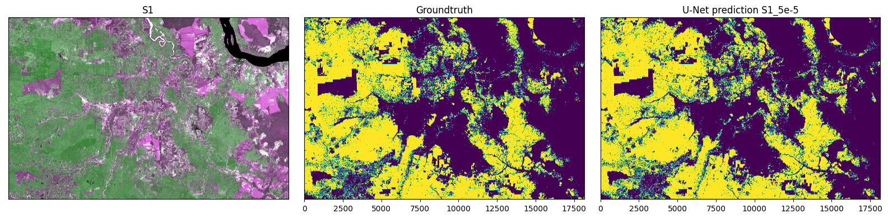
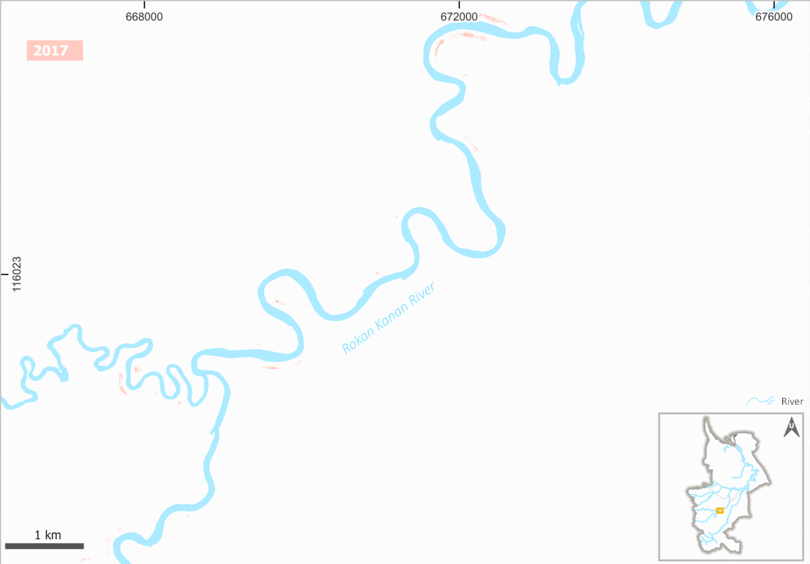

## Oil Palm Deep Learning (OPDL)

This is a repository for oil palm segmentation from Sentinel-1 SAR and/or Sentinel-2 MS using neural network. Part of MSc thesis at Faculty of ITC, University of Twente, supervised by Iris van Duren and [Raian V. Maretto](https://research.utwente.nl/en/persons/raian-vargas-maretto). The model was trained on the Faculty of ITC' [CRIB](https://platform.crib.utwente.nl/).  

We deployed the model, which was trained on 2020 data, to map oil palm across years. We focused our analysis on the riparian area which should have been protected.

An interactive view of the oil palm map along rivers produced from this study can be accessed [here](https://geografif.github.io/opdl/map). 

